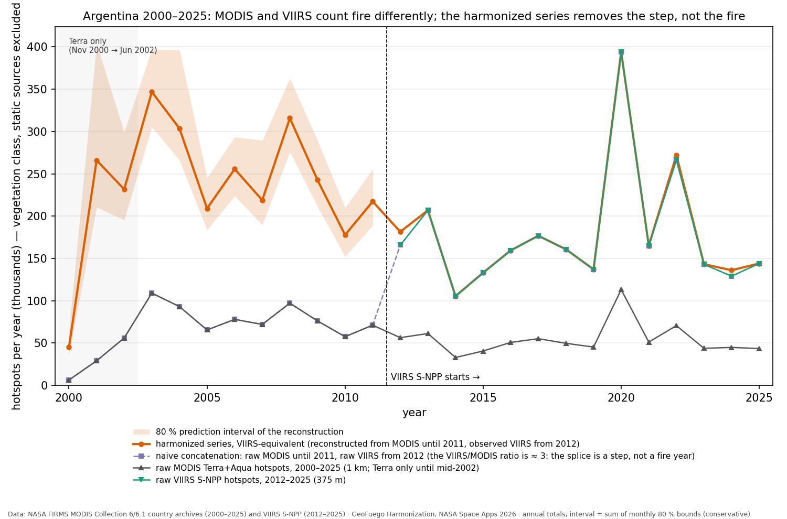

# GeoFuego Harmonization

**One consistent fire-hotspot calendar for Argentina, November 2000 → December 2025, from two sensors that count fire differently** — MODIS (2000→, 1 km) converted to VIIRS-equivalent counts, with a calibrated uncertainty band on every reconstructed month. The 2026 months are shown in the app as a preliminary near-real-time layer (NASA FIRMS Area API, NOAA-20/21 converted to S-NPP-equivalent through the bridge), outside the harmonized record.

NASA Space Apps Challenge 2026 · Challenge: *Harmonization of MODIS and VIIRS Hot Spots* (CONAE) · Local event: Buenos Aires · Team: **GeoFuego.com.ar**

DOI (this work): https://doi.org/10.5281/zenodo.24220107 · App: https://spaceapps.geofuego.com.ar/ · Every number below is reproduced by the scripts in this repository from NASA FIRMS data.

## In thirty seconds

**The problem.** Argentina's hotspot record is two records: MODIS since 2000 and VIIRS since 2012. VIIRS sees ≈ 3 fire pixels where MODIS sees one, and the ratio changes with region, calendar month, satellite overpass time and the kind of heat source. Glued together, the record shows a false jump in 2012 (≈ 2.3× in the national series, ≈ 3× locally); kept apart, a fire manager cannot compare this season with 2008.

**What we built.** A conversion factor per 0.25° cell × calendar month × satellite set, fitted on the days both sensors flew (2012–2023), with shrinkage to province, fire-regime region and country where a cell has too little data; a static-source class (gas flares, industry, and MODIS's own summer false alarms) kept as a separate column; satellite outages filled across sensors; and an 80 % prediction interval calibrated out of sample and then tested on two years never used.

**Five numbers (all out of sample).**

| | |
|---|---|
| Fire-season error of the reconstruction, leave-one-year-out 2012–2023 | **3.2 % country · 9.8 % province · 30 % single cell** (a national scalar: 8.9 / 15.0 / 34 %) |
| Drift of the ratio between 2012–17 and 2018–23, after fixing a labelling change in the MODIS archive | **≈ 3 %** (it read ≈ 9 % before the fix) |
| 80 % interval tested on 2024 and 2025, years used neither for the factors nor for the band | cells **80 % / 77 %** · areas of 2–199 cells **77–81 % / 73–77 %** · provinces **76 % / 73 %** (2024 / 2025; 2025 is the year of strongest Terra/Aqua orbit drift) |
| Continuity across the 2012 splice: burned hectares per hotspot before vs after (MCD64A1) | **0.98** harmonized vs **3.12** naive concatenation |
| Static-source cells separated from vegetation fire (flares, kilns, MODIS summer false alarms) | **1 628** cells of 0.02°, 3.0 % of hotspots; 56 % of Neuquén's 2012–2025 detections |

## How to use it

- **`data/harmonized/harmonized_provinces.csv`** — 24 provinces + Argentina, month by month, Nov 2000 → Dec 2025: `H` (VIIRS-equivalent hotspots, vegetation class), `H_lo`/`H_hi` (80 % interval; empty for observed VIIRS months), `sensor` (VIIRS · MODIS→VIIRS-eq · MODIS-Terra→VIIRS-eq), `gap_fill` and outage-day counts, `cloud_anom`/`cloud_underdetection` (ERA5 cloud at the overpass: a flagged month is likely a lower bound), `static` (separate column, never subtracted silently), `factor_source` (estimated | assigned).
- **`data/harmonized/harmonized_cells.csv`** — the same per 0.25° cell (4 193 cells, 291 k rows): sum cells for any area of interest; the interval for an aggregate comes from `band_calibration.json` → `by_region_size[set][region][size_class]` (size class by the number of cells: 1 · 2–9 · 10–49 · 50–199 · 200+; bin by the aggregate's predicted count; whole country: `by_region_class[set].national.agg`). Both CSVs open with `#` comment lines: read them with `comment='#'` in pandas or skip lines starting with `#`.
- **`data/harmonized/cells.json.gz`** (1.1 MB) — the app payload: per cell, 26 × 12 harmonized counts, sensor flag, static counts, gap-fill and cloud flags, plus the interval bins by region and class and the province → region table.
- **`data/factors/factors.csv`** — the factor itself per cell × month × set with its weight and level of origin; `bridge.csv` — S-NPP ↔ NOAA-20 / NOAA-21 (g = 0.979 / 0.951) for the live 2026 series.
- **Read first:** Known limits below. Before 2012 a small area reads zero where MODIS saw nothing (44 % of VIIRS-active cell-months), and the static-source class removes more than half of Neuquén's hotspots from the vegetation calendar by design.

## What the challenge asks → where it is

| the challenge statement asks for | in the app (https://spaceapps.geofuego.com.ar/) |
|---|---|
| MODIS and VIIRS harmonized, "so that the sensor of origin no longer matters" | panel *In 2012 the satellite changed*: naive splice vs MODIS alone vs harmonized, for the selected area, with a yearly table (downloadable as CSV) that lists the harmonized total, its 80 % range and the raw count of each satellite: MODIS Terra + Aqua, VIIRS S-NPP, and NOAA-20 / NOAA-21 for 2023–2025 · [Argentina](https://spaceapps.geofuego.com.ar/#aoi=ar) |
| "select a region": draw the area of interest or enter latitude and longitude | province list, Lat / Lon, cells or rectangle on the map · [a point in Córdoba](https://spaceapps.geofuego.com.ar/#pt=-31.4,-64.5) |
| "a specific date range" | From / to · [Corrientes 2020–2022](https://spaceapps.geofuego.com.ar/#prov=Corrientes&from=2020-01&to=2022-12) |
| a calendar of hotspots "from the early 2000s to the present" | *Burning-activity calendar*, November 2000 → today · [Corrientes](https://spaceapps.geofuego.com.ar/#prov=Corrientes) |
| "which periods of the year see more fires, which years had more burning activity" | *Which months of the year*, *Which years burned most*, critical months and worst year in the summary strip |
| "compare the burning activity of the current month against the historical median" | *This month vs the historical median* (month to date, last complete month, year to date) |
| "anomalies against multi-year averages", "unusual conditions" | calendar in Anomaly mode (month ÷ median of the same month) · notable fire events, e.g. [Corrientes 2022](https://spaceapps.geofuego.com.ar/#case=corrientes-2022) |
| "accessible color ramps" | Colours: Viridis and Cividis (colour-blind safe) besides the default Fire ramp |
| "download analytics and visualizations", "a downloadable CSV file of hot spots detected during a search" | PNG of the calendar · CSV of the area by month · CSV with one row per 0.25° cell and month with hotspots, both for the selected area and dates. The harmonized record is a count per cell and month, so its finest unit is the cell-month; individual detections (point, time, FRP) remain available from NASA FIRMS |

## The series in one figure

Raw MODIS runs through 2025 and falls after 2011 as much as the harmonized series does (2003–2011 mean over 2012–2025 mean: 1.48 raw MODIS, 1.41 harmonized): the lower fire activity of the VIIRS era is real, the ≈ 3× step of the naive splice is not.

## What this is, in more detail

MODIS (2000→, 1 km) and VIIRS (2012→, 375 m) count fire differently, and the ratio between them is not a constant: it depends on region, calendar month and satellite overpass time, and it is a different ratio altogether for persistent thermal sources (gas flares, industry). This repository contains:

1. A **harmonization engine**: a VIIRS/MODIS factor per 0.25° cell × calendar month × satellite set (Terra+Aqua; Terra only), fitted as a ratio of sums on **paired days** of the **2012–2023** overlap (orbit-drift years 2024–2025 excluded), with hierarchical shrinkage cell → province → fire-regime region → country (the four GFI regions: NEA, NOA, Centro, Patagonia, the same province-to-region table GeoFuego uses for its climatologies and ENSO calibration). The cell level is estimated where the overlap has enough MODIS detections (**28 % of cell-months**); the other 70 % inherit the province (or region) value. Shrinkage constant K = 10 (K = 10 and 20 are within fold noise; CAP is inert).
2. A **static-source class**, kept as a separate column, never dropped. Two physical rules catch thermal sources (gas flares, refineries, kilns, sawmill boilers, landfills): *persistent* (≥ 9 months in 12 **and** ≥ 50 % night) and *intermittent* flares (≥ 4 months in 12, ≥ 70 % night, median VIIRS FRP < 3 MW). A third rule fixes an input defect: the FIRMS MODIS `type` flag changes with the archive version (type 2 is 0.4–1.8 % of detections through 2017 and 2.3–4.9 % from 2018, the same fixed sites), so cells with ≥ 3 MODIS type-2 detections in ≥ 2 years of 2018–2025 are static in all years for both sensors; their pre-2018 type-0 detections have 11 % VIIRS same-day co-location (76 % elsewhere), 97 % daytime, FRP 8 MW, peak Dec–Feb: hot bare surfaces, not fire. 1 628 cells of 0.02° (204 + 469 + 955), 3.0 % of hotspots; Neuquén 56 %, Santa Cruz 28 %, Tierra del Fuego 18 % of their 2012–2025 detections are in the class (flares). 97 % of VIIRS `type = 2` detections fall inside the class (65 % with the two physical rules alone; the third rule uses NASA's flag, so this is partly by construction).
3. A **harmonized monthly series 2000 → 2025** per cell, province and country in VIIRS-equivalent counts, with sensor-of-origin flag, satellite-outage gap filling across sensors (incl. the S-NPP pre-operational days of January 2012), and an **80 % prediction interval calibrated on out-of-sample residuals**, asymmetric, binned by predicted count (1–5 … 3000+) and satellite set, fitted per fire-regime region and per **size class of the area** (1 cell · 2–9 · 10–49 · 50–199 · 200+ cells): a single cell with a prediction is a selected over-prediction, a small aggregate is under-predicted by the structural zeros of its other cells, and the residual distribution shifts with size, so classes 2–199 are calibrated on random contiguous blocks drawn in every leave-one-year-out fold; the country and areas of 200+ cells use the province/country residual bins. The lower bound never exceeds the value.
4. A **bridge S-NPP ↔ NOAA-20 / NOAA-21** (g = 0.979 / 0.951, fitted on 2023–2025 standard-processing archives on paired days) so that the series continues on the newer satellites (the FIRMS near-real-time feed of S-NPP carries no detections over Argentina after 2 November 2026) and the 3-satellite live series can be expressed in S-NPP-equivalent units.
5. A **web app** (`deploy/`, https://spaceapps.geofuego.com.ar/) where the user draws any area of interest (or picks a province, or enters a point), picks a date range, and gets the calendar Nov 2000 → today, the current month vs the historical median, the ranking of years and months, the fixed-heat-source series, and downloads for the selected area and dates (PNG of the calendar; CSV of the area month by month; CSV with one row per 0.25° cell and month with hotspots); plus a summary strip per area (critical months holding ≥ 80 % of a typical year, typical and worst year, out-of-sample fire-season error for that country / province / area size), calendar values in every cell with year totals, a median row and a Count / Anomaly switch (month ÷ median of the same month), colour scales Fire / Viridis / Cividis, a before/after panel per area (raw MODIS, raw VIIRS, the naive splice and the harmonized series: nationally the splice jumps ≈ 2.3× at 2012 while MODIS alone, flying on both sides, does not) with a yearly table of the harmonized total, its range and the raw count of each satellite (NOAA-20 and NOAA-21 for 2023–2025), the share of the selected hotspots that VIIRS observed, that was reconstructed from MODIS and that is preliminary (*Where the number comes from*), the out-of-sample validation numbers, a Method & validation page (`deploy/method/`) and an About page with the two videos (`deploy/about/`), notable fire events as permalinks (`#case=`), each with a NASA satellite image of the area before and after the fires (MODIS Terra, false colour; context only; a click opens it over the whole window, with zoom and pan), hotspots on the map, a year-by-year and month-by-month fire film of the selected area (the country, a province or any drawn area, framed on the map and coloured on its own scale), and a table that maps every request of the challenge statement to the place in the app that answers it. It is a static client (vendored Leaflet, Leaflet.draw, uPlot; no server; the only external requests are the basemap tiles and the Cloudflare Web Analytics beacon that Pages injects at the zone level) that implements the application rules of the round-4 review (`docs/peer_review_round4_nasa.md` §3, R1–R13): snapping to whole cells, four size tiers, interval by region × size class, baseline 2012–2025 for small areas, Terra-only era only for ≥ 100 cells, Tierra del Fuego from 2012, static sources never added, cloud and outage markers, "factor borrowed" label, and a preliminary current year (`scripts/07_live_2026.mjs`: FIRMS Area API, standard processing to July, NRT after; same grid, same static class, bridge g = 0.979 / 0.951; per day, mean over the satellites operating that day; months carry the count of days with 3/2/1/0 satellites).

All code in this repository was written during the hackathon window (14–15 Nov 2026, Buenos Aires time), with intensive SI coding assistance (see *Super Intelligence (SI) acknowledgment*). What existed before the window opened is listed in *Pre-existing work (disclosure)*.

## Validation at a glance (`docs/audit_2026-11-14.md`, `docs/peer_review_fable52.md`)

| test | result |
|---|---|
| Leave-one-year-out 2012–2023 (interpolation), fire-season error, Terra+Aqua set | country **3.2 %** · province **9.8 %** · single cell 30 % (naive national scalar: 8.9 / 15.0 / 34 %) |
| Split-window tests (extrapolation in time): train 2012–17 → test 2018–23 and the reverse | country predicted/observed **0.965** and **0.992** (Terra-only 0.93 / 1.01): the ratio drifts ≈ 3 % between the two halves (it was ≈ 9 % before the MODIS type-flag fix, which explained a third of it), so the honest country-level error for 2002–2011 is **≈ 3–5 % if the 2012–2023 relation held in 2002–2011** — nothing independent of MODIS can test that (see Known limits) |
| Ablation ladder (province error) | scalar 15.0 → country×month 13.1 → +region 12.8 → +province 12.8 → +cell **9.8 %** (the cell level carries the gain; region and province levels govern only the share a unit cannot estimate itself) |
| Forward test on years never used (Terra+Aqua) | 2024: predicted/observed **1.044** · 2025: **1.024** (Terra-only: 0.88, 0.75 = measured orbit drift) |
| Backward test inside the MODIS era, 2003–2011: Terra-only reconstruction vs Terra+Aqua reconstruction | country **0.94–1.04** per year; province-year 80th pct \|log\| 0.21: supports the 2000–mid-2002 years |
| Terra-only set (used 2000 – mid 2002) | country 5.6 % · province 16.8 % · worst year 0.80; **multiplicative limit**: where MODIS saw nothing the model returns zero (on paired days 2012–2023, 44.9 % of VIIRS-active cell-months, holding 7.2 % of VIIRS hotspots, have no Terra+Aqua detection; 67 % and 20 % for Terra alone; `05h_structural_zeros.mjs`), and where MODIS saw little it over-predicts (in 23 % of Terra-only cell-months with predicted 5–15, VIIRS observed zero) |
| 80 % prediction interval, calibrated **per fire-regime region, size class of the area and predicted count**; coverage measured **out-of-sample for the band itself** (`band_calibration.json`, `size_bins_test.json`) | country 89 % · province 79 % · cell 81 % · random areas of 2–9 / 10–49 / 50–199 cells 80 / 80 / 80 % (64 / 73 / 79 % with the province bins); **months with predicted count 5–30: 77–79 % in every size class** (64–72 % before); Neuquén 77 %, Chubut 71 % (n 35); **Tierra del Fuego not verifiable** (3 province-months with predicted count ≥ 30 in 2012–2023; 33 % coverage) |
| **80 % interval on years never used for factors or bins** (2024, 2025; Terra+Aqua; `05_loyo.mjs` forward block, `05g_size_bins.mjs`) | cell-months **80 % / 77 %** · random areas of 2–9 / 10–49 / 50–199 cells **81 / 80 / 77 %** in 2024 and **77 / 74 / 73 %** in 2025 · areas of 200+ cells **76 % / 64 %** (n 528 / 576; 83 % / 68 % with the national aggregate bins) · province-months **76 % / 73 %** (n 206) · country 10 and 11 of 12 months. The 2025 figures of the large classes carry the Terra/Aqua orbit drift of that year (MODIS reads 12–25 % low), which the interval was not built to absorb. Terra-only set on those years: 74 % / 71 % province, 58 % / 50 % country — the Terra-only interval is calibrated for the nominal-orbit era (2000–mid 2002), and 2024–2025 Terra is 12–25 % low from orbit drift |
| Consistency across the 2012 splice vs MODIS burned area (MCD64A1) | burned ha per hotspot pre/post 2012: **0.98** harmonized vs **3.12** naive concatenation (not an independent validation: MCD64A1 is trained with MODIS active fires, and raw MODIS on both sides gives 0.98 too) |
| S-NPP/NOAA bridge vs production NRT data (different pipeline) | 0.982 vs 0.979 (NOAA-20); provincial spread (w > 0.9) 0.93–1.16 (NOAA-20), 0.89–0.99 (NOAA-21) |
| ENSO dependence of the ratio (team hypothesis) | real (r = −0.30 monthly, −0.35 annual; `enso_tests.json`) but small; conditioning did not improve out-of-sample skill → carried as extra band width in strong-phase months |
| Cloud obscuration (ERA5 cloud fraction by overpass hour + precipitation, 0.25°) | cloud does **not** bias the factor (differential 13:30−10:30 anomaly vs LOYO residual: r = 0.02); it does lower counts: conditional on rain, +0.10 cloud anomaly ≈ −26 % detections for both sensors → counts not corrected, every cell-month carries `cloud_anom` / `cloud_underdetection`, upper bound widened in reconstructed months |
| Day/night split factors (reviewer suggestion) | night VIIRS/MODIS ratio **6.1–6.7** vs day **2.7–3.0** (physics confirmed), but separate day and night factors give no net skill gain (country 3.3 → 2.9 %, province 10.2 → 10.6 %, cell 29.7 → 30.8 %): the pooled cell×month factor already absorbs the local day/night mix → not adopted, kept as an option |
| Additive term for months where MODIS saw nothing (reviewer suggestion) | fixes single cells (Terra-only cell error 54 → 42 %) but degrades every aggregate and both out-of-time tests → not adopted; the structural zero of small pre-2012 AOIs stays declared |

## Known limits (declared)

**Nothing independent validates 2000–2011.** The factors are fitted on 2012–2023 and every out-of-time test (split windows, 2024–2025) stays inside the VIIRS era; the only pre-2012 checks are internal (Terra-only vs Terra+Aqua reconstructions, burned area from a product that itself uses MODIS active fires). The reconstruction is correct to the degree that the MODIS/VIIRS relation of 2012–2023 held before 2012; the measured drift inside the VIIRS era (≈ 3 % between halves after the type-flag fix) is the best available bound on that assumption, not a test of it.

**Small areas still show the sensor change.** MODIS at 1 km misses fire that VIIRS at 375 m sees. On the paired days of 2012–2023, the share of VIIRS-active months in which MODIS saw nothing and the model therefore predicts zero is 45 % for one cell, 38 % for blocks of 4 cells, 26 % for 25, 17 % for 100, 6 % for a province and 0 % for the country (`data/validation/structural_zeros.json`); those months hold 7 % of VIIRS hotspots for one cell, 3 % for 4 cells and 0.2 % for 100 cells. For areas under about 25 cells, the frequency of fire months before and after 2012 is not comparable, and a zero before 2012 means "no MODIS detection", not "no fire". The app follows size tiers for this reason (`docs/peer_review_round4_nasa.md` §3).

**The Terra-only era (November 2000 – June 2002) is shown only for areas of 100 cells or more.** Before Aqua joined, the reconstruction rests on one satellite: fire-season error 16.8 % per province (9.8 % with Terra + Aqua), worst year 0.80, and Terra alone saw nothing in 67 % of the VIIRS-active cell-months (45 % with both). Errors average out over large areas, not over small ones, so for areas under 100 cells the app leaves those months out of the calendar and of every statistic, and the harmonized annual series of the before/after panel starts in 2003, the first complete Terra + Aqua year (the raw MODIS line still starts in 2001). Rule R5 of `docs/peer_review_round4_nasa.md`.

**The MODIS archive mixes file versions** (6.2 through 2017, 6.03 for 2018–2022, 61.03 for 2023–2025, all Collection 6 / 6.1 processing). FIRMS serves the country archives this way; we treat them as one series because the detection algorithm is the same, and we found and handled the one field whose meaning changed (`type`, rule 3 of the static class). A fully reprocessed single-collection MODIS record would remove this caveat.

**The app and the province file differ in two small, known ways.** The app payload stores whole counts per cell, so a sum of cells differs from `harmonized_provinces.csv` by under 0.1 % in the country and in 20 of 24 provinces (Buenos Aires −0.3 %), and by more than 2 % only in some single months, most of them under 100 hotspots. Before 2012 the app widens the upper bound for cloud from an anomaly of +0.10 (rule R9) and the province file from +0.05, so the upper bound differs in 23 % of province-months (the file is wider in 17 %); lower bounds agree in all but a few months.

Observed VIIRS months carry no interval (they are the reference); the interval of Tierra del Fuego cannot be verified (3 province-months with enough fire in 2012–2023) and the intervals of Pampa/Cuyo provinces are wider than needed (coverage 85–94 %); a cloudy month still reads low (obscuration is measured and flagged, not corrected); day and night detections are pooled (split tested, no gain); the four regions are the GFI's (declared, reused for consistency with GeoFuego); the factors of Tierra del Fuego and of the City of Buenos Aires are **assigned** from their region, not estimated (own weight below 0.5: 180 and 8 MODIS detections in August over 12 years; Tierra del Fuego's December factor rests on a single 2022 event), and are labelled so in the province CSV (`factor_source`); for Tierra del Fuego the app shows 2012–2025 only; the static class is time-invariant and removes the vegetation fire that occurs inside its 1 628 cells (0.4–0.5 % of VIIRS hotspots per year; before 2012, 0.5 % of MODIS detections nationally, 15 % in Neuquén — but only the detections that precede a cell's first year of persistent night activity can be vegetation fire the mask wrongly removes: **0.3 % nationally, 6.4 % in Neuquén**, 4.3 % Santa Cruz, 44 % of Tierra del Fuego's 130 detections; `scripts/audit_flare_start_year.mjs`. A dated mask was not implemented: the gain is below the interval width everywhere except Tierra del Fuego, where nothing is estimable) and MODIS type-2 detections outside those cells (≈ 0.7 %) are treated differently before and after 2018; the outage detector conditions on MODIS zeros (effect < 1 % of counts per year; all 7 outages of ≥ 8 days and 13 of the 24 runs of ≥ 3 days match official NASA mission records (2 more partially), `data/validation/outages_vs_official.json`); the unit is VIIRS-equivalent 375 m pixel counts, not fires nor area; Argentina only.

## Pipeline

`npm run all` (or step by step) — `01_fetch` → `02_grid` → `03a_static_sources` → `03b_coverage` → `03_aggregate` → `04_factors` → `05_loyo` (+ `05b` consistency, `05c` AOI curve, `05d` ha-per-hotspot, `05e` ENSO, `05g` size bins) → `06_harmonize` → `04b_bridge` → `07_live_2026` (preliminary current year) → `08_app_payload` (builds `deploy/data`: copies `cells.json` and `cells_2026.json`, writes `oni.json`, `provincias.json`, `skill.json` and `raw.json`, keeps the per-satellite counts in `data/agg/viirs_sp_annual.json`, stamps the asset version in `index.html` and verifies the vendored libraries against `deploy/vendor/SHA256SUMS.txt`). Figures: `fig_*.py`. Everything runs with Node ≥ 20 and Python 3 (numpy, matplotlib). App locally: `npm run app && npm run app:serve` → http://127.0.0.1:8080/ (`scripts/serve.mjs` applies the production headers of `deploy/_headers`, incl. the Content-Security-Policy; binds to 127.0.0.1 only).

### Reproduce

Three levels, from no network to everything:

1. **From the versioned intermediates, no network, no credentials** (≈ 1 min): `node scripts/04_factors.mjs && node scripts/05_loyo.mjs && node scripts/05c_aoi_error.mjs && node scripts/05g_size_bins.mjs && node scripts/06_harmonize.mjs`. Inputs: `data/agg/counts.json`, `coverage.json`, `static_cells.json`, `cloud_cells.json.gz`, `precip_cells.json.gz`, `data/grid/`, `data/external/oni/`. Expected `sha256`: `data/harmonized/cells.json` `bd5b76b2…`, `harmonized_provinces.csv` `f294551a…`, `harmonized_cells.csv` `76c2aa09…` (every output JSON also carries a `generated` timestamp, which is the only field that changes between runs). `06_harmonize` refuses to run without the cloud input (pass `--no-cloud` to build a product without the cloud flag; it will differ from the published one). Validation from the same inputs: `npm run validate` (≈ 1 min; `05f` and the static audit need the raw CSVs, see level 3).
2. **From the raw hotspot archives** (≈ 600 MB of FIRMS CSVs + 60 MB of ERA5, published in the Zenodo record): put them in `data/raw/` and `data/external/era5/`, then `npm run build` (≈ 75 s) regenerates `data/agg/*` and the products above byte for byte.
3. **From the sources**: `npm run fetch` needs a free FIRMS MAP_KEY (`~/.config/nasa/firms-map-key`) and a free Copernicus CDS key (`~/.cdsapirc`, package `cdsapi`); Python needs `pip install -r requirements.txt` (numpy, matplotlib, netCDF4, cdsapi). `npm run fetch:bridge && npm run bridge` rebuilds the S-NPP ↔ NOAA-20/21 bridge; `npm run live` the preliminary current year (date-dependent); `npm run app` the app payload (and verifies the vendored libraries against `deploy/vendor/SHA256SUMS.txt`).

## Data

- **NASA FIRMS** active fire archive by country: MODIS (2000–2025; the `version` column reads 6.2 up to 2017, 6.03 for 2018–2022 and 61.03 for 2023–2025 — all Collection 6 / 6.1 archive products, treated as one series except for the `type` flag, which is not homogeneous across versions and is handled by rule 3 of the static class) and VIIRS S-NPP (2012–2025) — `scripts/01_fetch.mjs`, sha256 of every file in `data/raw/MANIFEST.json`.
- **NASA FIRMS Area API**, standard processing: VIIRS S-NPP, NOAA-20, NOAA-21 2023–2025 over Argentina (bridge, and the per-satellite columns of the yearly table in the app) — `scripts/01b_fetch_viirs_sp.mjs` (needs a free FIRMS MAP_KEY in `~/.config/nasa/firms-map-key`).
- **NOAA CPC Oceanic Niño Index** and **GWIS/JRC burned-area tables (MCD64A1, MVP64)** — `scripts/01c_fetch_aux.mjs`; Argentina rows committed in `data/external/`.
- **ERA5** (Copernicus Climate Data Store): monthly cloud fraction by hour of day and monthly precipitation, 0.25°, 2000–2025 — `scripts/01d_fetch_era5_cloud.py`, `01e_fetch_era5_precip.py` (needs a free CDS key); sha256 in `data/external/MANIFEST_aux.json`.
- **`deploy/data/raw.json`** (app payload, `scripts/08_app_payload.mjs`): annual raw hotspot counts per 0.25° cell, 2001–2025, vegetation class, static sources excluded, in each sensor's own units. `m` = MODIS Terra + Aqua and `v` = VIIRS S-NPP from the country archives (`data/agg/counts.json`); `vs` / `n20` / `n21` = VIIRS S-NPP / NOAA-20 / NOAA-21 for 2023–2025 from the FIRMS Area API standard-processing files, all days, same filters, clipped to the Argentine provinces. The per-cell counts of those three are versioned in `data/agg/viirs_sp_annual.json` (written by the same script when the raw CSVs are present, read from the repository otherwise), so the payload rebuilds without the raw files. Country totals 2023 / 2024 / 2025: S-NPP from the Area API over S-NPP from the country archive 1.000 / 0.998 / 0.999; NOAA-20 over S-NPP 0.951 / 1.030 / 0.991; NOAA-21 over S-NPP 1.009 / 0.957 for 2024 / 2025 (the NOAA-21 file of 2023 starts on 1 March, so that year is partial and marked as such in the app). The script prints these ratios and stops if a complete year falls outside 0.90–1.10.
- **NASA Worldview Snapshots / GIBS**: MODIS Terra corrected reflectance, bands 7-2-1 (false colour, at the native 250 m of the layer), one image before and one after each of the six notable fire events of the app — `scripts/01f_fetch_case_images.mjs`; the twelve files are in `deploy/assets/cases/` with dates, bounding boxes, request URLs and sha256 in `cases.json`, and `08_app_payload` checks them. They are context for the reader: no number is computed from them.
- Raw hotspot CSVs are not committed (≈ 1 GB); derived products are published in the Zenodo record.

## Data sources and licences

| source | used for | licence / terms | citation |
|---|---|---|---|
| NASA FIRMS active fire country archives: MODIS C6/6.1 (2000–2025), VIIRS S-NPP (2012–2025); FIRMS Area API standard processing: S-NPP, NOAA-20, NOAA-21 (2023–2025) | all counts, factors, series, bridge | NASA data: public domain / free and open (NASA Earth Science Data and Information Policy); FIRMS asks for acknowledgment | "We acknowledge the use of data and/or imagery from NASA's Fire Information for Resource Management System (FIRMS), part of NASA's Earth Science Data and Information System (ESDIS)." Giglio, Schroeder & Justice (2016); Schroeder et al. (2014) |
| NASA Worldview Snapshots / GIBS: MODIS Terra corrected reflectance, bands 7-2-1 | before / after images of the notable fire events in the app (context only, no computation) | NASA data and imagery: free and open; NASA asks for acknowledgment | "We acknowledge the use of imagery from the NASA Worldview application (https://worldview.earthdata.nasa.gov), part of the NASA Earth Science Data and Information System (ESDIS)." |
| ERA5 monthly cloud fraction by hour of day and total precipitation, 0.25° (Copernicus Climate Data Store) | cloud obscuration flag and interval widening | Copernicus licence (free, attribution): "Contains modified Copernicus Climate Change Service information 2026; neither the European Commission nor ECMWF is responsible for any use of this information" | Hersbach et al. (2020) QJRMS 146, doi:10.1002/qj.3803; dataset doi:10.24381/cds.f17050d7 |
| NOAA CPC Oceanic Niño Index | ENSO tests and band widening | US Government work, public domain | NOAA Climate Prediction Center, ONI |
| GWIS / JRC country profiles: MCD64A1 burned area tables | consistency check across the 2012 splice | GWIS data: free, attribution (European Commission JRC; Copernicus Emergency Management Service) | Giglio et al. (2018) RSE 217 (MCD64A1); GWIS country profiles |
| Estado hídrico de la Argentina 2001–2026 (monthly percentiles per department of ERA5-Land temperature, precipitation and soil moisture, and MODIS MOD13A3 NDVI; pre-existing dataset by the team, published before the hackathon) | context line for the preliminary 2026 months in the app (no computation in this repository uses it) | CC BY 4.0; underlying ERA5-Land: Copernicus licence; MOD13A3: NASA open data | Copernicus Argentina & Kovacevic, G. R. (2026), Zenodo, doi:10.5281/zenodo.24035880; Muñoz-Sabater et al. (2021) ESSD 13 (ERA5-Land); Didan (2021) MOD13A3 v061 |
| IGN Argentina province polygons (simplified, via GeoFuego) | cell → province assignment | Instituto Geográfico Nacional, open data (Ley 27.275; CC BY-style attribution) | IGN Argentina, Capas SIG |
| Leaflet 1.9.4, Leaflet.draw 1.0.4, uPlot 1.6.31 (app, vendored) | web app | BSD-2-Clause, MIT, MIT | LICENSE files in `deploy/vendor/` |
| Basemap tiles from `server.arcgisonline.com`: Esri World Imagery, World Boundaries & Places, World Topo Map, World Dark Gray Canvas (base and reference) | background map of the app only (no computation, nothing redistributed in this repository) | proprietary, free to display with attribution under Esri's terms of use; not open data | © Esri, Maxar, Earthstar Geographics, and the GIS User Community; © Esri, HERE, Garmin, OpenStreetMap contributors (shown on the map) |
| Basemap tiles from `gibs.earthdata.nasa.gov` (NASA Global Imagery Browse Services, public WMTS): VIIRS NOAA-20 corrected reflectance, true colour, of the previous day; Black Marble night lights 2016 | two optional background maps of the app (no computation, nothing redistributed in this repository) | NASA data and imagery are open; acknowledgment requested | We acknowledge the use of imagery provided by services from NASA's Global Imagery Browse Services (GIBS), part of NASA's Earth Science Data and Information System (ESDIS) (shown on the map) |
| Cloudflare Pages (static hosting) and Cloudflare Web Analytics | hosting; the analytics beacon is injected at the zone level | service terms of Cloudflare; no cookies | — |

## Pre-existing work (disclosure)

What existed before the hackathon window opened (14 Nov 2026, 09:00 ART):

- **GeoFuego** (https://geofuego.com.ar), the team's live national fire-monitoring platform (NASA FIRMS ingestion every 3 h, provincial calendar, GeoFuego Index), and its published method package (concept doi:10.5281/zenodo.23017739; current version v1.2.0, doi:10.5281/zenodo.24164911), including the province-to-region table and the simplified IGN province polygons reused here (`lib/regions.js`, `lib/provincias.js`).
- A written method design (13 Nov) and a submission plan.
- A preliminary feasibility check of the MODIS/VIIRS ratio run in Sept–Nov 2026 on the public FIRMS archives (a leave-one-year-out comparison of a cell-monthly factor against a national scalar, used to decide that the approach was worth building). Its numbers are not reused: this repository recomputes everything from the raw data.
- The public FIRMS archives already downloaded, the vendored front-end libraries, and an empty placeholder page at spaceapps.geofuego.com.ar (13 Nov).
- **Estado hídrico de la Argentina 2001–2026** (doi:10.5281/zenodo.24035880), a monthly ERA5-Land / MODIS NDVI dataset by department published by the team before the hackathon; the app quotes it in one context line for 2026 and no computation here depends on it.

Everything else — the code, the datasets, figures, validations and documents in this repository — was produced inside the window.

## Super Intelligence (SI) acknowledgment

This project was built with intensive SI assistance: **Claude (Anthropic)**, via Claude Code / OpenClaw. SI wrote most of the code under the team's direction, ran the analyses, drafted and edited the English text, and debugged and tested the app.

**SI reviews.** The method and the app were reviewed by SI systems (Claude) in isolated sessions, in five rounds plus two topical reviews: `docs/peer_review_fable52.md` (round 1), `docs/peer_review_round2.md`, `docs/peer_review_round3_judge.md`, `docs/peer_review_round4_nasa.md`, `docs/peer_review_round5_engineering.md`, `docs/peer_review_round5_user_test.md`, `docs/bridge_review.md`, `docs/static_sources_review.md`. Each says in its first line that it was produced by SI. The two round-5 reports were written in Spanish for the team and are published here as literal English translations (the Spanish originals remain in the git history). A third round-5 report, on the presentation and the submission, is not part of this repository.

**Who decided what.** The idea — harmonizing MODIS to VIIRS with a regional, calendar-month factor instead of a national scalar, carrying the series from 2000 to the present for Argentina — is the team's and predates the hackathon (see *Pre-existing work*). The SI reviews **proposed**; the team **decided**, and every proposal was measured before being adopted or rejected. Proposals tested and rejected with numbers are in `docs/audit_2026-11-14.md`: ENSO as a correction of the factor, day/night factors, an additive term for months where MODIS saw nothing, a date-dependent flare mask, and a region × level interval variant. The application rules R1–R13 that the app implements were proposed by the round-4 review and adopted by the team after reading it; the specification document (`docs/app_handoff.md`) says so.

**What carries the acknowledgment.** Every script carries the header `Written with SI assistance (Claude, Anthropic); reviewed and validated by the team.` The published products (`harmonized_cells.csv`, `harmonized_provinces.csv`, `cells.json`) carry the same acknowledgment in their headers, and the app says it in its footer; intermediate files (`data/agg`, `data/factors`, `data/validation`) do not, and are documented by the scripts that write them. Every number reported is produced by the scripts in this repository from NASA FIRMS data. The GeoFuego logo shown in the app header (`deploy/assets/`) is pre-existing and was generated with SI; no figure, chart, map or data value in this repository is SI-generated. The 30-second demo video is presented by an SI-generated character, Max, one of the AI agents the team works with: his still image is pre-existing and SI-generated, the lip-sync animation of the introduction was made with Hedra and the voice of the whole video with ElevenLabs. A visible label ("AI-generated presenter and voice") is on screen while he appears, and the About page of the app and the video description say it in text; every screen after the introduction is the real app, recorded as it runs. No NASA branding is used in any generated content.

## License

- Code: MIT (see `LICENSE`). Data products and figures: CC BY 4.0 (see `LICENSE-DATA`).

## Citation

See `CITATION.cff`. References: Giglio, Schroeder & Justice (2016) RSE 178; Schroeder et al. (2014) RSE 143; Giglio et al. (2018) RSE 217 (MCD64A1); Hersbach et al. (2020) QJRMS 146 (ERA5); NOAA CPC ONI; GWIS/JRC country profiles; IGN Argentina.
